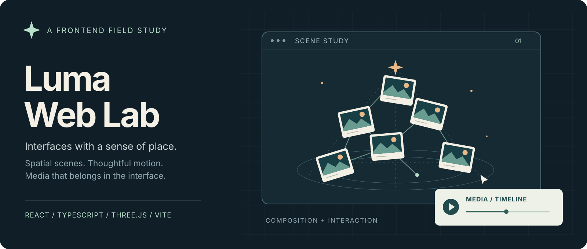
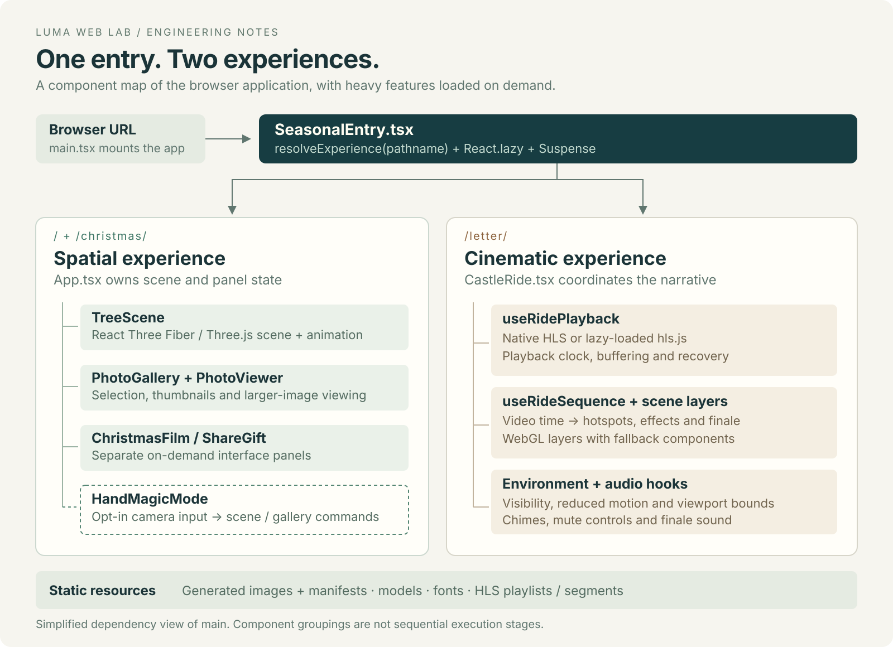
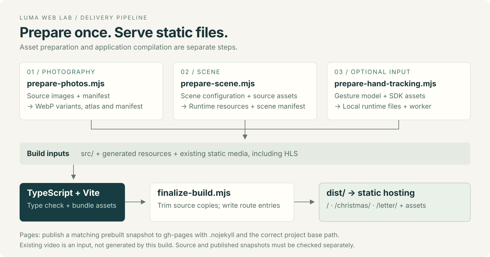

<p align="center">
  <strong>React · TypeScript · Three.js · Vite</strong><br />
  <a href="#architecture">Architecture</a> ·
  <a href="#asset-pipeline">Asset pipeline</a> ·
  <a href="#run-locally">Run locally</a> ·
  <a href="#deployment">Deployment</a>
</p>

## A website can feel like a place

Luma Web Lab is a frontend design-and-engineering study of spatial scenes, photography, video, and touch interaction. A seasonal WebGL experience and a cinematic narrative share one application entry, while keeping their heavier features separate and loading them on demand.

The cover is an original illustration, not a screenshot. Its abstract image tiles contain no personal photographs. This is an experimental application, not a production-ready component library or site builder.

## Interface studies

| Study | Design question | Implementation focus |
| --- | --- | --- |
| **Spatial composition** | Can a collection of images become a navigable scene? | Three.js, React Three Fiber, camera interaction and animation. |
| **Photo browsing** | How does a scene open into a useful gallery? | Texture preparation, thumbnails, selection and larger-image viewing. |
| **Cinematic UI** | Can controls and interactions coexist with a continuous film? | HLS playback, timeline-driven effects, audio and recovery. |
| **Touch and gesture** | What changes when the interface is used on a phone? | Portrait layouts, safe areas, touch targets and optional camera input. |

## Architecture



*Figure 1. A simplified dependency view of the `main` source branch. The groups show component responsibilities, not sequential execution stages or a claim that the deployed build matches this source snapshot.*

[`SeasonalEntry`](src/SeasonalEntry.tsx) selects an experience from the URL. [`App`](src/App.tsx) owns the spatial scene and its panels; [`CastleRide`](src/journey/CastleRide.tsx) coordinates the video-led experience. Scene, gallery, film and gesture interfaces are loaded separately rather than treated as one eagerly loaded screen.

The video route uses [`useRidePlayback`](src/journey/useRidePlayback.ts) for native HLS or lazy-loaded `hls.js`, with buffering and recovery state. Its playback clock feeds the narrative sequence. Gesture mode is optional; a visitor does not need to enable the camera to use the scene or gallery.

<details>
<summary><strong>Follow the implementation</strong></summary>

| Area | Starting point |
| --- | --- |
| Entry and route selection | [`src/SeasonalEntry.tsx`](src/SeasonalEntry.tsx), [`src/lib/experience-route.ts`](src/lib/experience-route.ts) |
| WebGL scene | [`src/scene/TreeScene.tsx`](src/scene/TreeScene.tsx) |
| Photo interface | [`src/components/PhotoGallery.tsx`](src/components/PhotoGallery.tsx), [`src/components/PhotoViewer.tsx`](src/components/PhotoViewer.tsx) |
| Optional gesture input | [`src/components/HandMagicMode.tsx`](src/components/HandMagicMode.tsx), [`src/hand-tracking/`](src/hand-tracking/) |
| Video and narrative | [`src/journey/CastleRide.tsx`](src/journey/CastleRide.tsx), [`src/journey/useRidePlayback.ts`](src/journey/useRidePlayback.ts), [`src/journey/useRideSequence.ts`](src/journey/useRideSequence.ts) |

</details>

## Asset pipeline



*Figure 2. Source media becomes runtime assets before application compilation. Existing films are inputs to this pipeline, not generated by it.*

The preparation scripts produce image variants, scene resources and local gesture-recognition assets. Vite bundles the application and copies public resources. [`finalize-build.mjs`](scripts/finalize-build.mjs) removes redundant source copies from the output and writes real `letter/index.html` and `christmas/index.html` entries, so direct links need not depend on a server-side SPA fallback.

<details>
<summary><strong>Asset preparation scripts</strong></summary>

| Script | Responsibility |
| --- | --- |
| [`prepare-photos.mjs`](scripts/prepare-photos.mjs) | Photo variants, atlas and runtime manifest. |
| [`prepare-scene.mjs`](scripts/prepare-scene.mjs) | Scene configuration and runtime resources. |
| [`prepare-hand-tracking.mjs`](scripts/prepare-hand-tracking.mjs) | Gesture model, SDK runtime files and worker assets. |
| [`finalize-build.mjs`](scripts/finalize-build.mjs) | Output cleanup and static route entries. |

The diagrams are editable, self-contained SVG files in [`.github/readme/`](.github/readme/). They require no diagram-rendering service or remote font and can be updated alongside the code.

</details>

## Run locally

Use Node.js **20.19 or newer** and npm. From a checkout of the source branch:

```bash
npm ci
npm run dev
```

Asset preparation runs before development and production builds. The first gesture-model preparation may require network access. Generated resources live in `public/generated/`; keep the source assets needed to recreate them.

```bash
npm run lint
npm test
npm run build
npm run preview
```

| Local route | Experience |
| --- | --- |
| `/` | Seasonal scene and gallery entry. |
| `/christmas/` | Explicit seasonal-scene route. |
| `/letter/` | Cinematic narrative; the established path is retained for compatibility. |

For project-site hosting, these routes sit beneath the configured deployment base path.

## Design and validation

**Atmosphere without losing orientation.** Keep navigation and playback controls understandable inside the visual scene.

**Progressive loading and restrained motion.** Load heavy features when needed; account for reduced-motion preferences, background tabs and rendering limits.

**Real-device evidence.** A passing build does not establish smooth mobile WebGL, reliable audio or comfortable touch interaction. Record the browser, viewport and interaction sequence, and distinguish real-device tests from desktop emulation.

## Deployment

`main` contains a source snapshot; `gh-pages` contains a separately versioned prebuilt GitHub Pages snapshot. **Check that the intended source and generated assets match before replacing a published build.** Rebuilding an older source snapshot is not guaranteed to reproduce the current deployment.

Publish the complete `dist/` output, preserving the root entry, both route entries and referenced resources. For branch-based Pages publishing, include `.nojekyll` at the root and select `gh-pages` / `/(root)` in the repository settings.

A repository rename changes the project-site base path. Migrate HTML, CSS, JavaScript and route normalization together; renaming alone is not a deployment migration. Custom domains and DNS are separate operations.

## Contributing and permissions

Focused improvements to loading, keyboard interaction, touch ergonomics, reduced motion, rendering cost and media playback are welcome. Describe what was actually tested and preserve applicable third-party attribution.

This repository does not currently declare a repository-wide open-source license. Public visibility is not a blanket permission to reuse its contents. Photographs, videos, audio, fonts, models and production materials are distinct from the interface code and remain subject to their own permissions and licenses. Use your own appropriately licensed media when adapting an experiment.
